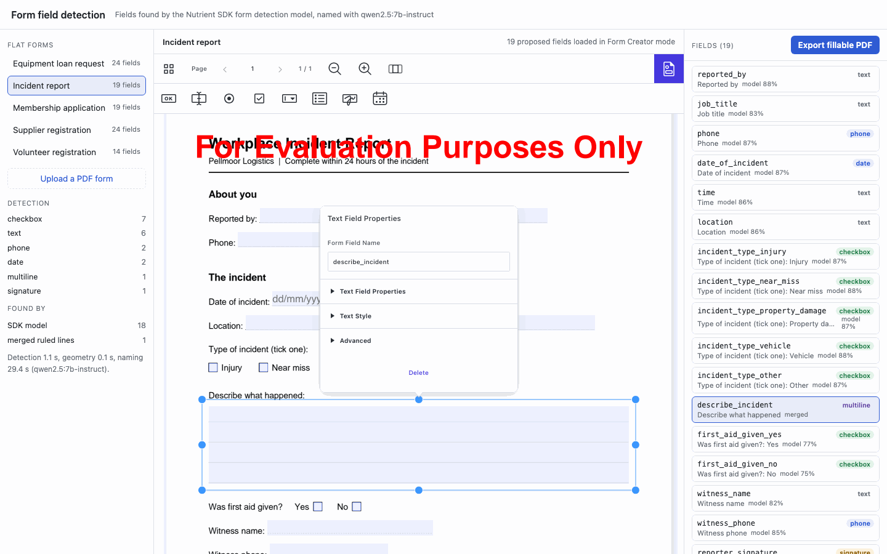
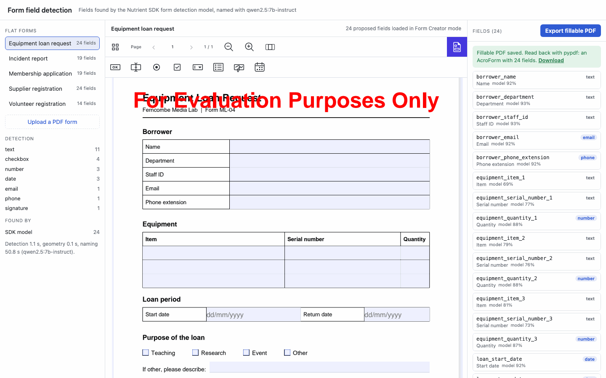
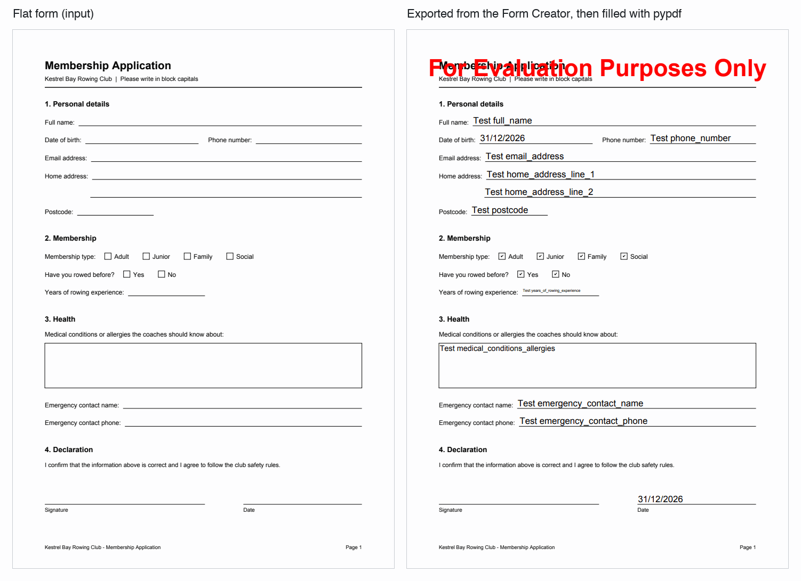

# Nutrient Form Field Detection

A Nutrient.io demo that turns flat PDF forms into fillable ones: the Nutrient Python SDK finds the fields, layout rules and a local LLM label, type and name them, and a person checks them in the Nutrient Web SDK Form Creator before exporting the fillable PDF.



1. **Detect.** `Vision.detect_forms()` of the Nutrient Python SDK runs the SDK's form field detection model on every page, offline. It returns text areas, check boxes and signature areas, each with a box and a confidence. Fields under 50% confidence are dropped.
2. **Snap to the drawing.** The SDK renders the pages (`export_as_image`, 200 DPI). OpenCV finds the lines, boxes, table cells and empty squares drawn on them, and the PDF text layer gives the underscores and dots typed as text. Each model field is moved onto the exact line or box it belongs to. Geometry proposals in places the model left empty are added. Consecutive ruled lines with no caption of their own become one multi-line field.
3. **Read the captions.** The PDF text layer (pdfplumber) gives every word with its position. For each field the demo collects the text on its left, right, above and below, the column header and the section heading. Layout rules pick the caption: the text on the left; the text just above a box; the small text under a line ("Signature"); for a check box, the option on its right (or left) and the question of its row.
4. **Type and name.** Rules set the type from the caption: date, email, phone, signature, number, multi-line or text. `qwen2.5:7b-instruct` names each field in snake_case from its caption and the text around it, one call per page (`full_name`, `borrower_department`, `incident_type_near_miss`). It may only turn a plain text field into a date, email, phone or number field.
5. **Review.** The page opens the flat PDF in the Nutrient Web SDK in Form Creator mode and creates every proposal as a real form field: a widget annotation and a text field (multi-line where needed; date fields get a `dd/mm/yyyy` format action), check box or signature field. Move, resize, rename, delete or add fields with the Form Creator tools; the list on the right follows the changes.
6. **Export.** `instance.exportPDF()` writes the fillable PDF. The server keeps it and reads its AcroForm back with pypdf, as a check.

Everything runs locally. Detection takes about 1 second per page, the LLM names about 30 seconds per page on a laptop. `LABELS=rules` skips the LLM.

## Prerequisites

- Python 3.10 or later (tested with 3.13)
- macOS on Apple Silicon, Linux x64 or Windows x64 (the Nutrient Python SDK native runtimes). Tested on macOS on Apple Silicon.
- [Ollama](https://ollama.com/download) with `qwen2.5:7b-instruct` (16 GB of RAM recommended), or any OpenAI-compatible endpoint. Not needed with `LABELS=rules`. `qwen2.5vl:7b` only for the `sdk-vlm` comparison.
- A browser with internet access: the page loads Nutrient Web SDK 1.24.0 from the Nutrient CDN
- Disk space for the form detection model that the Python SDK downloads to `~/.local/share/Nutrient` on first use (about 190 MB here)
- Flat forms with a text layer, such as forms printed to PDF from a word processor. See Limitations for scans.

## Environment variables

Keys are only read from environment variables, never from code. Start from `.env.example`.

| Variable | Purpose | Default |
|---|---|---|
| `NUTRIENT_LICENSE_KEY` | Nutrient Python SDK license key (detection) | empty = evaluation mode |
| `WEB_SDK_LICENSE_KEY` | Nutrient Web SDK license key, sent to the browser by `GET /api/config` | empty = evaluation mode |
| `LABELS` | `llm`: captions and types by rules, names by the LLM. `rules`: no LLM. `llm-only`: the LLM decides captions, names and types. `sdk-vlm`: the SDK's own labeling with a vision model | `llm` |
| `LLM_BASE_URL` | OpenAI-compatible endpoint that names the fields | `http://localhost:11434/v1` |
| `LLM_MODEL` | Naming model | `qwen2.5:7b-instruct` |
| `LLM_API_KEY` | API key of that endpoint | empty (Ollama needs none) |
| `VLM_BASE_URL`, `VLM_MODEL`, `VLM_API_KEY` | Vision model for `LABELS=sdk-vlm` | the `LLM_` endpoint, `qwen2.5vl:7b` |
| `MIN_CONFIDENCE` | Model fields below this confidence are dropped | `0.5` |
| `FORMS_FOLDER` | Flat forms listed on the page | `samples/forms` |
| `OUTPUT_FOLDER` | Proposals, uploads, exported PDFs, evaluation | `output` |
| `HOST`, `PORT` | Address of the review page | `127.0.0.1`, `4710` |

## Build and run

```bash
python3 -m venv .venv
```

```bash
.venv/bin/pip install -r requirements.txt
```

```bash
ollama pull qwen2.5:7b-instruct
```

```bash
.venv/bin/python detect.py
```

```bash
.venv/bin/python server.py
```

Open <http://localhost:4710>. To use the values from `.env`, load them first with `set -a && source .env && set +a`. On Windows, use `.venv\Scripts\python`.

`detect.py` writes `output/proposals/<form>.json` for every sample form, in about 3 minutes with the LLM (`--labels rules`: a few seconds). `detect.py --file <form.pdf>` runs one form. The server runs `detect.py` for forms that have no proposals yet, such as uploads, in a separate process each time: an evaluation session of the Python SDK lasts one hour, a process per form keeps a long-running server working.

## Using the app

1. Pick a sample form on the left, or **Upload a PDF form**. An upload is detected and named before it opens (about 30 seconds per page with the LLM).
2. The form opens in the Form Creator with every proposed field. The left panel counts the fields by type and by origin (SDK model, geometry, merged ruled lines), with the time each step took.
3. Click a field in the list to select it in the document. Drag it, resize it, or use its properties to rename or delete it. The Form Creator toolbar adds new fields of every kind: text, check box, radio button, list, signature, date. The list shows each field's name, type, caption and origin (`model 92%` is the detection confidence).
4. Click **Export fillable PDF**. The server stores the PDF and reads it back with pypdf; the result and a download link appear above the list.

   

The exported PDF works in any PDF reader and with any form tool. Here it is filled by pypdf and rendered by PDFium, next to the flat original:



## API

| Method and path | Description |
|---|---|
| `GET /api/config` | `{ web_sdk_license_key, labels, llm }` |
| `GET /api/forms` | The forms: id, file, number of proposed fields (null before detection), exported or not |
| `GET /api/forms/{id}/pdf` | The flat PDF |
| `GET /api/forms/{id}/proposals` | The proposed fields; runs the detection first if there are none. Each field has `page`, `rect` (PDF points, origin top left), `name`, `label`, `type`, `kind`, `source`, `confidence`, `snapped_to` and the text around it (`context`) |
| `POST /api/forms/{id}/detect` | Runs the detection again |
| `POST /api/upload?name=form.pdf` | Raw PDF body. Returns `{ id }` |
| `POST /api/forms/{id}/export` | Raw PDF body (the PDF exported by the Web SDK). Stores it and returns `{ file, acroform, count, fields }` read with pypdf |
| `GET /api/forms/{id}/fillable.pdf` | The stored fillable PDF |

## Evaluation

```bash
.venv/bin/python evaluate.py
```

The sample generator writes the list of fields each form was designed with: 100 fields on 6 pages. A proposed field matches a true field when their rectangles overlap with an intersection over union (IoU) of at least 0.5. The script reports precision and recall, the mean IoU of the matched fields, the kind (text, check box, signature) and the type, and the names and captions: exact, or close when at least half of their words are the same (`date_of_incident` and `incident_date` are close). "Counted names" are names that had to be made unique by adding a number (`item_2`, `postcode_2`).

The fifth form (`volunteer-registration`) was written after the rules, to measure how they work on a layout they were not written for: captions printed inside the boxes, a comb of character boxes, "D.O.B." and "E-mail". Its scores are also shown alone.

Results on an Apple Silicon laptop, Nutrient Python SDK 1.0.13 in evaluation mode:

| Configuration | Precision | Recall | Mean IoU | Type | Names close | Captions close | Counted names | Seconds (6 pages) |
|---|---|---|---|---|---|---|---|---|
| SDK model, rule names | 100/100 | 100/100 | 0.827 | 99/100 | 88/100 | 88/100 | 7 | 4.8 |
| Geometry only, rule names | 90/99 | 90/100 | 0.966 | 90/90 | 83/90 | 79/90 | 13 | 0.7 |
| SDK model + geometry, rule names | 100/100 | 100/100 | 0.946 | 99/100 | 88/100 | 88/100 | 7 | 5.5 |
| SDK model + geometry, LLM only | 100/100 | 100/100 | 0.946 | 90/100 | 78/100 | 69/100 | 8 | 203 |
| **SDK model + geometry, rule captions and types + LLM names (default)** | 100/100 | 100/100 | 0.946 | 99/100 | 88/100 | 88/100 | 0 | 151 |
| SDK model + geometry, SDK labeling with `qwen2.5vl:7b` | 100/100 | 100/100 | 0.946 | 83/100 | 64/100 | 59/100 | 11 | 1278 |

On the held-out form alone (14 fields):

| Configuration | Recall | Mean IoU | Type | Names close | Captions close |
|---|---|---|---|---|---|
| SDK model + geometry, rule names | 14/14 | 0.822 | 13/14 | 8/14 | 9/14 |
| Geometry only | 4/14 | 0.961 | 4/4 | 3/4 | 0/4 |
| LLM only | 14/14 | 0.822 | 14/14 | 11/14 | 8/14 |
| Default (rules + LLM names) | 14/14 | 0.822 | 13/14 | 11/14 | 9/14 |

What the numbers say:

- **The SDK model finds every field**, on all five layouts, including the held-out one: lines, typed underscores and dots, boxes, table cells, check boxes, signature lines and the comb (as one field). It reads lines as a box about 27 pt high around the line, which is why the geometry pass snaps them: the mean IoU goes from 0.83 to 0.95.
- **Geometry alone is precise but brittle.** It was written for the first four layouts and finds 4 of the 14 fields of the held-out form (it treats boxes with a caption inside as labels). It is used to place the model's fields exactly, not to find them.
- **The 7B LLM is a good namer and a poor layout reader.** Left to read the layout on its own, it sometimes takes the option of the previous check box, or mixes up captions and names, and its types drop to 90%. Given the captions that the rules found, it keeps the rules' types and gives names that say which field it is: no name needs a counter, against 7 with rules alone (the rows of the item table, and a second `postcode` on the held-out form where the address box took the wrong caption), and the held-out names go from 8 to 11 of 14. Only 42 names are exactly those of the ground truth; most of the others differ by style, such as `borrower_department` against `department`.
- **The SDK's own labeling** (`enable_ai_labeling` with `qwen2.5vl:7b` through Ollama: numbered marks on the page image, sent to the vision model) read 59 of 100 captions right and took about 3.5 minutes per page. Reading the text layer is faster and more accurate for forms that have one. The labeling is run with `python evaluate.py --with-sdk-vlm`.
- The LLM results vary a little from run to run (an earlier run of "LLM only" had 95/100 types and 82/100 captions).

The exported PDFs are checked end to end in a headless browser: with the server running,

```bash
.venv/bin/pip install -r requirements-dev.txt && .venv/bin/playwright install chromium
```

```bash
.venv/bin/python tests/check_export.py
```

opens every form on the page, clicks **Export fillable PDF**, then checks the exported file with pypdf: an AcroForm with every proposed field, by name, with the right kind (`/Tx`, `/Btn`, `/Sig`) and the multi-line flag; then fills every text field and check box, saves, and reads the values back. Result: 5 of 5 forms, 100 AcroForm fields, 95 of 95 values filled and read back (the 5 signature fields are left for signing).

## Evaluation mode

The demo runs without license keys. In evaluation mode:

- the Python SDK form detection, the page images and the text are complete; nothing is hidden or watermarked in what this demo uses;
- the Web SDK draws "For Evaluation Purposes Only" over the pages and writes it into the exported PDF;
- each evaluation session of the Python SDK is limited to one hour, so the server runs each detection in its own process.

`Vision.extract_content()` of the Python SDK, which returns the words with their boxes, replaces about half of the paragraphs with "This content is hidden in trial mode" in evaluation mode. The words and their positions are read from the PDF text layer with pdfplumber instead.

## Samples

`samples/forms` holds five flat forms of invented organisations, generated by `samples/generate_forms.py`, each with its ground truth `<form>.fields.json`:

| Form | Style | Fields |
|---|---|---|
| `membership-application.pdf` | Captions on the left of drawn lines, check box rows, a box, signature and date lines with captions underneath | 19 |
| `equipment-loan-request.pdf` | Word-processor tables: label cells and value cells, an item table with a header row, check boxes | 24 |
| `supplier-registration.pdf` | Two pages, captions above boxes, a two-row grid of check boxes | 24 |
| `incident-report.pdf` | Underscores and dots typed as text, four ruled lines for one answer, options on the left of their check boxes | 19 |
| `volunteer-registration.pdf` | Held out: captions inside the boxes, grey format hints, a comb of character boxes, options in two columns | 14 |

To regenerate them:

```bash
.venv/bin/pip install -r samples/requirements.txt
```

```bash
.venv/bin/python samples/generate_forms.py
```

## Limitations

- **Scanned forms.** The model detects fields on scans too, since it works on the page image, but the captions come from the text layer, which a scan does not have. For scans, run OCR first (the Python SDK `PdfEditor.make_searchable()` writes a text layer) or use `LABELS=sdk-vlm`. Not tested here.
- **Held-out layout.** On the held-out form, captions printed inside a box are found when the model's field starts below the caption, which it did for 8 of the 9 boxes. The address box took the caption under it ("Postcode") instead. The four check boxes got their option ("Saturdays") but not the question of the section, and "D.O.B." was not typed as a date. 9 of 14 captions are right and the LLM names 11 of 14 well; a reviewer fixes the rest in the Form Creator.
- **Radio buttons.** The SDK model does not report radio buttons (as its guide says), so a group of options becomes separate check boxes. Turn them into a radio group in the Form Creator if needed.
- **Combs.** A comb of character boxes becomes one text field, without a character count.
- **Model.** Tested with `qwen2.5:7b-instruct` for names. A stronger model would read layouts better and could take over the captions; with this model, the rules do that part. The SDK's own labeling with `qwen2.5vl:7b` was much slower and less accurate than reading the text layer (see the table); a stronger vision model may change that, which matters for scans.
- **Field sizes.** A field on a line covers the 18 points above the line; the font size is automatic.
- **Ground truth.** Names and types in the ground truth are one designer's choice (is a sort code a number?), which is why names are also scored as "close".

The Python SDK can also add fields in one call, `PdfEditor.detect_and_add_form_fields()`, with generated names and no review. It is not used here: this demo adds captions, types, names and the review step.

## Project layout

| Path | Content |
|---|---|
| `detect.py` | Propose the fields of a folder of forms, or of one form |
| `formdetect/sdk.py` | Nutrient Python SDK: form detection, optional AI labeling, page images |
| `formdetect/geometry.py` | OpenCV and text-layer proposals, snapping, merging of ruled lines |
| `formdetect/textlayer.py` | Words with positions, and the text around each field |
| `formdetect/naming.py` | Captions and types by rules, names by the LLM |
| `formdetect/pipeline.py` | The steps in order |
| `server.py`, `web/` | Review page with the Nutrient Web SDK Form Creator, export |
| `evaluate.py` | Detection and naming against the ground truth |
| `tests/check_export.py` | Export, fill and read back the fillable PDFs |
| `samples/` | Flat forms, their ground truth and their generator |
